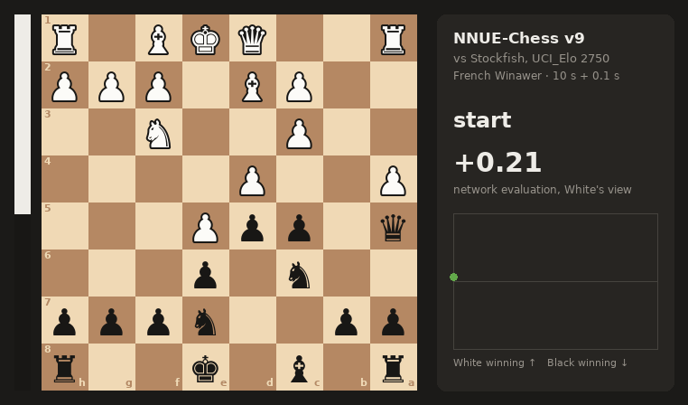
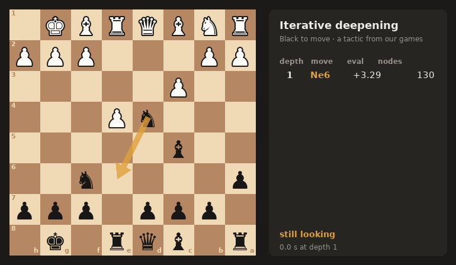
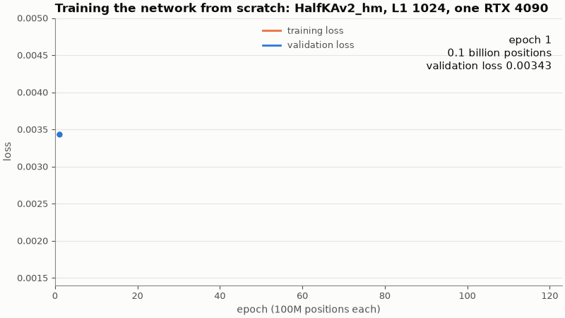
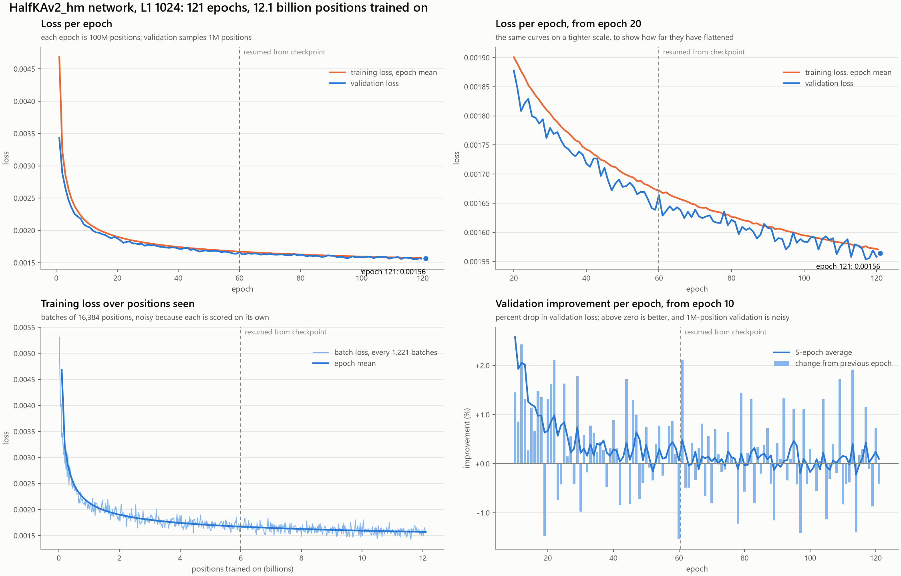
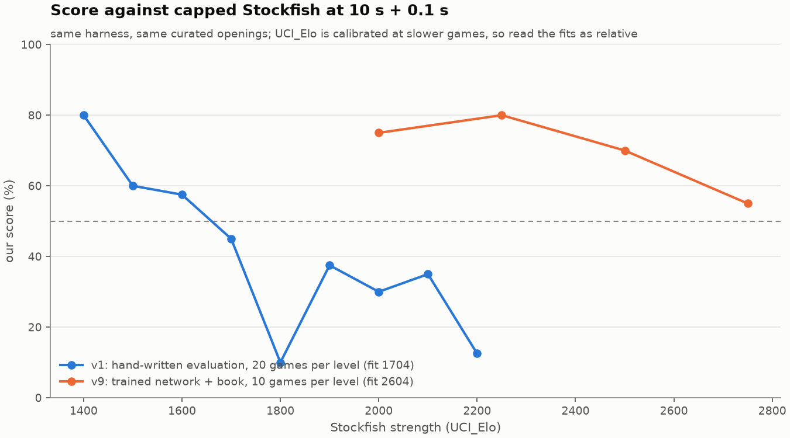

# NNUE-Chess

Team **Claude's Gambit**'s entry for [AI Chessathon](https://aichessathon.com): a Python
alpha-beta engine with a neural evaluation trained from scratch on a RTX 4090

<p align="center">
  
</p>

**Current build: v14, at the repo root.** It plays a HalfKAv2_hm network (L1 1024) trained for
121 epochs on 12.1 billion positions, searched by compiled code: `position.py`, `evaluation.py`
and `search.py` run inside numba, and `agent.py` keeps only the clock, the opening book and
iterative deepening. It is v9b's search rule for rule at about 13× the nodes a second, and it
beat v9b **+6 =2 −0** over 8 games at 10 s + 0.1 s.

**The build that played the event was v9b**, the same search in Python. It scored 6 wins, 2 draws
and 5 losses, 7 / 13, in the 13-round final Swiss on 11 Sep 2026, and against Stockfish capped
with `UCI_Elo` at 10 s + 0.1 s, 75% at 2000, 80% at 2250, 70% at 2500 and 55% at 2750. The
hand-written v5 it replaced scored 45% at 1700. Last updated 17 Sep 2026.

## Contents

- [The competition](#the-competition)
- [The engine](#the-engine): search, the network, the opening book
- [Training the network](#training-the-network): data, GPU, curves, export
- [How strong it is](#how-strong-it-is): versions, the Stockfish ladder, the event
- [Is it safe to submit](#is-it-safe-to-submit): limits and rules, checked
- [After the deadline](#after-the-deadline): the compiled rewrite, and what it cost to measure
- [Where the strength goes](#where-the-strength-goes)
- [Layout](#layout), [Running it](#running-it), [Fair play](#fair-play), [Next](#next)

## The competition

The whole submission is a zip with `agent.py` at its root, exposing one function:

```python
def get_move(fen: str, time_left_ms: int) -> str: ...
```

| | |
|---|---|
| Clock | 120 s + 0.5 s per move, per side, on wall time |
| Hardware | one core of an AMD EPYC 9V74 at 2.60 GHz, 2 GB RAM, no network, no GPU |
| Start-up | 90 s to import the agent, before the clock starts |
| Size | 50 MB unzipped, weights and books included |
| Environment | Python 3.12 with torch 2.13 (CPU), numpy 2.5, python-chess 1.11, onnxruntime 1.29, numba 0.67; no native binaries |
| Filesystem | read-only apart from 256 MB at `/tmp` |
| Openings | rated games start from curated positions, not the standard start |
| Networks | trained by the team; engine-labelled training data is allowed |
| Tables | opening tables for positions at move 20 or lower, endgame tables up to 7 pieces; anything that answers a middlegame counts as an engine |
| Schedule | hourly rated rounds from 4 Sep, uploads closed 11 Sep 11:00, the 13-round Swiss over locked builds that afternoon, and the live final in London on 12 Sep |

[aichessathon.com/docs](https://aichessathon.com/docs) is canonical and changes.

## The engine

`agent.py` is the submission, and holds only what runs once a move: the clock, the opening book,
iterative deepening with aspiration windows, and a legal answer whatever goes wrong. The search
itself is compiled, in three modules numba turns into machine code as they are imported:

| Module | What it holds |
|---|---|
| `position.py` | Bitboards, pseudo-legal move generation, make and unmake, Zobrist keys, static exchange evaluation |
| `evaluation.py` | The network's accumulators and score cache, and the hand-written evaluation as the fallback |
| `search.py` | Principal variation search: the table, move ordering, pruning, reductions, quiescence |

python-chess still reads the FEN, plays the book and checks the reply, but the search never
touches it: one `board.push()` costs about 13 µs, where a whole compiled node costs well under
one. A move is packed into a single int32, and every compiled function has its argument types
written out, so each is compiled once when its module is imported rather than once per constant a
caller passes. Compiling everything at import took the 90 s start-up budget once, and now measures
67.7 s of it on this laptop — the tightest number in the build, and the one to watch.

### Search

| Technique | What it does here |
|---|---|
| Iterative deepening, aspiration windows | Searches depth 1, 2, 3... and keeps the last finished result. Windows start ±40 cp around the previous score. |
| Principal variation search | Fail-soft negamax. Only the first move gets a full window. |
| Transposition table | 1M entries keyed on the position, depth-preferred replacement, kept across moves in a game. |
| Move ordering | TT move, then captures by MVV-LVA with losing captures demoted by static exchange evaluation (SEE), then killers, then history. |
| Internal iterative deepening | From depth 5, a node with no TT move runs a shallow search first to find one. |
| Null-move pruning | Skips a turn. If the position still fails high, prunes it. |
| Reverse futility, futility, late move pruning | Prune nodes whose static eval is far outside the window, up to depths 6, 4 and 5. |
| Late move reductions | Quiet moves late in the ordering search shallower, by a log-based table. |
| Mate distance pruning, check extensions | Prefer the shortest mate, and search one ply deeper when in check. |
| Quiescence search | Captures only, with stand-pat, delta pruning and SEE pruning of losing captures. |

Time management gives each move `time_left / 34` plus 85% of the increment, which the engine
measures rather than trusts, and switches to `/ 45` under 25 seconds. At the real clock that is
about 3 to 4 s a move and depth 8 to 10, against v9b's median 8 over the 802 moves it searched at
the event. With 800 ms left it answers in 43 ms, and with 150 ms it does not search at all.

The rules above are v9b's, unchanged. Two things behave differently in compiled code: running out
of time sets a flag and every node returns at once, where the Python search raised an exception,
and the unfinished iteration is thrown away; and the transposition table is a fixed array indexed
by the key rather than a dictionary, so two positions can collide for one of its 1M slots.
Depth-preferred replacement is kept for a key already there. The collisions are why the compiled
engine does not search exactly the same number of nodes as v9b.

<p align="center">
  
</p>

### Checking it against the engine it replaced

A rewrite this size is only safe if it can be held against something known. `make verify`
(`tools/verify_compiled.py`) does that and exits non-zero on the first mismatch:

| Check | Against | Result |
|---|---|---|
| perft | published move-path counts, 6 standard positions | all 6 match |
| Legal moves | python-chess, move for move, over positions from random games | 5,403 positions match |
| Hash keys | a key computed from scratch, and restored exactly by unmake | 5,403 positions match |
| Static exchange | the Python version in `versions/v9b` | 19,253 captures match |
| Evaluation | `versions/v9b`, hand-written and network | 5,403 positions; the network to 2.6e-06, 1 of them a centipawn apart after rounding |
| Accumulators | a full rebuild, through skipped evaluations, null moves and moves taken back | 2,976 evaluations; largest difference 2.6e-06, none a centipawn apart |

### Evaluation: a network trained from scratch

`nnue_eval.py` runs a **HalfKAv2_hm** network in the shape Stockfish's trainer produces, written
out and executed by our own code:

| Part | Shape |
|---|---|
| Inputs | 22,528 sparse features: 32 king buckets × 704 piece-square planes, mirrored so the king is always on files e to h |
| Feature transformer | 22,528 → 1,024 per side to move, plus 8 piece-square outputs; clamped to [0, 1], then the two halves of each side multiplied pairwise |
| Layer stacks | 8, chosen by piece count: 1,024 → 32 → 64 (squared and linear clipped ReLU) → 32 → 64 → output reading both hidden layers |
| Size | about 23.5M parameters; 23.07M of them in the feature transformer |

- **Inference** is numba, and the engine can reach a score two ways. `forward()` rebuilds both
  accumulators from the piece bitboards (de Bruijn bit scans, SWAR popcount) and reads the first
  hidden layer as 32 dot products over all 1,024 inputs: that is what v9b and v13 play, at
  **35.2 µs** a call. v14 keeps the accumulators up to date move by move, which takes an
  evaluation down to **12.3 µs** when it finds them current — a saving the search is not yet
  collecting, [below](#keeping-the-accumulators-up-to-date). Scores are cached by transposition
  key, 524,288 entries.
- **Weights** ship as `weights/nnue.pt`, 47,986,486 bytes: the feature transformer in float16,
  the rest in float32, computed in float32. Our forward pass matches nnue-pytorch's to
  **1.7e-6** in float32 and **7.5e-4** with the float16 weights. It gives the same score with
  colours swapped or files mirrored, to 5e-7.
- **Scale.** The search's pruning margins were tuned against the hand-written evaluation, pawn =
  100. A fit over 462 opening positions sets `TO_CENTIPAWNS = 100 / 288` for this net. The
  hand-written evaluation stays in `evaluation.py` as the fallback if the weights file is missing,
  and the agent prints which one it loaded.

Why `.pt` and not Stockfish's `.nnue` format? The format does not change speed here: the same
numba code runs either way. We serialised the epoch-60 checkpoint both ways to compare: `.nnue` was 47.1 MB
uncompressed and 24.2 MB with its default LEB128 compression, against 48.0 MB for our `.pt`. The
rules name `.pt` as an accepted format, and the build fits the cap with the book included.

#### Keeping the accumulators up to date

A move changes two to four of the 22,528 inputs, so bringing an accumulator forward should cost
far less than rebuilding it from thirty-odd pieces. v14 does that: a position carries an
accumulator per ply per side, `evaluation.py` fills one in only when a position is actually
evaluated, so a node cut off before its evaluation or a move found illegal costs nothing, and a
side whose own king moved is rebuilt because every input it has changed.

It is correct: `make verify` holds it against a full rebuild through skipped evaluations, null
moves and moves taken back. What it has not done is show up in the search. `tools/bench_eval.py`
times the routes over the 24 tactics positions, best of five passes, at the -O2 the agent sets:

| Route | Per call |
|---|---|
| `forward`: rebuild both accumulators, dense first layer | 35.2 µs |
| `refresh` + `head`: rebuild both accumulators, sparse first layer | 38.9 µs |
| `head` alone: accumulators already up to date | 12.3 µs |

Two things fall out of those three numbers. Rebuilding both accumulators is about 26 µs of the
cost, so an evaluation that finds them current costs 12.3 µs against 35.2 — under a third. And the
sparse first layer is the slower of the two heads by about 4 µs: walking the roughly 257 nonzero
inputs of 1,024 does about 8,000 multiply-adds where 32 dot products over all of them do 32,768,
and it still loses, because contiguous arithmetic numba can vectorise beats a quarter as much of
it behind a data-dependent index.

So the arithmetic says v14 should be well ahead, and the search says it is level: `tools/bench.py`
at depth 7 searches the same 674,405 nodes and solves the same 24 tactics either way, and the best
of three passes is 113,687 nodes a second for v13 against 116,177 for v14 — a 2% gap inside a
spread where the same build measured 54,701 and 113,687 on two passes an hour apart. Level, not a
win.

The saving is real and it is not being collected, and the likely reason is in how it is collected.
Accumulators are filled in only at nodes that are actually evaluated, which is the right way round
for a node cut off before its evaluation, but it means a quiescence search jumping around the tree
often finds no up-to-date ancestor to walk forward from: it rebuilds anyway, and then pays the
slower head on top. That is a hypothesis with an obvious instrument — count the rebuilds against
the walk-forwards — and it is the first thing to measure, along with giving the kept accumulators
the dense head.

One trap worth writing down, because it first read as the opposite result: with numba's on-disk
cache switched on (`NNUE_CHESS_CACHE_DIR`, [below](#running-it)) v14 measured 15 to 20% slower than
v13 across five paired runs, and without it the two are level. Compiled code that is loaded from
disk is not optimised across module boundaries the way freshly compiled code is, which would hit
v14's extra calls per evaluation hardest, but that is a guess: what is measured is that the cache
changes the comparison, and the platform never uses it. Benchmark without it.

### Opening book

`book/hiarcs_ref.bin` is the **HIARCS Reference Book Lite**: games between players rated 2550 or
more up to 2009, with computer and correspondence games excluded. It shipped as Arena's `.abk`
tree, and `tools/abk_to_polyglot.py` converts it:

- walks all 2,346,362 tree entries through python-chess, with 0 illegal moves;
- merges transpositions and weights each move by the games it was played in;
- keeps moves played in at least 3 games, and **only positions at move 20 or lower**;
- leaves 64,688 moves over 51,565 positions, 1.04 MB.

The agent plays the most-played move without searching, but only when the move number is 20 or
lower. The book is **not in this repository**: HIARCS allows personal use and forbids hosting the
file elsewhere. Without it the agent prints `opening book: none` and searches from move one.

| Sample opening | gm2001 (tried in v8) | HIARCS, trimmed |
|---|---|---|
| French Winawer | 2 plies | 11 plies |
| Grunfeld Defence | 15 plies | 26 plies |
| Sicilian Sveshnikov | 11 plies | 24 plies |
| English, Petroff, Scotch, French Classical, Sicilian Closed | none | none |

## Training the network

### Data

The rules allow any training data, including positions scored by an engine, as long as the team
trains the network itself.

- **Source:** six binpacks, `500M_d9_p1` to `p6`, from
  [jshriver/historic-binpacks](https://huggingface.co/datasets/jshriver/historic-binpacks)
- **Size:** 500M positions each by name, so about **3.0 billion positions** and 7.4 GB (about
  2.4 bytes a position)
- **Labels:** Stockfish scores at depth 9
- **Loading:** downloaded in about 5 minutes to `/dev/shm` so the loader reads from RAM
  (`training/vast/get_data.sh`)
- **Filtering:** the loader skips the first 12 plies of each game, captures and positions in
  check, and a share of the rest by game result, so it passes over the files several times

### Pipeline

[official-stockfish/nnue-pytorch](https://github.com/official-stockfish/nnue-pytorch) at
`9f72946` (July 2026), run exactly as the trainer ships. Nothing started from an existing network:
no `--resume-from-model` and no engine test net.

| Setting | Value |
|---|---|
| Features | `HalfKAv2_hm^` (factorised during training, 24,576 inputs; exported to 22,528) |
| L1 | 1,024 |
| Target | `--lambda 1.0`: the engine's score only, not the game result |
| Batch | 16,384 positions |
| Epoch | 100M positions (6,103 steps) |
| Validation | 1M positions per epoch, sampled from the same files |
| Optimizer | Ranger-lite, learning rate 4.375e-4 × 0.995 per epoch |
| Loader | 12 C++ workers, 4 torch threads |

### The GPU box

| | |
|---|---|
| Provider | vast.ai, one rented container |
| GPU | **NVIDIA GeForce RTX 4090, 48 GB** (49,140 MiB), driver 580.142 |
| Software | torch 2.11.0 + CUDA 12.8, Python 3.12 |
| Host limits | about 18.9 CPUs by cgroup quota, 234 GB RAM, 16 GB overlay disk, 31 GB `/dev/shm` |
| Load while training | about 56% GPU utilisation at 246 W and 1.8 GB of GPU memory; the CPU data loader, not the GPU, set the pace |
| Throughput | about 1.4M positions a second, 55 to 75 s an epoch |
| Checkpoints | 529 MB each, one every 5 or 10 epochs plus `last.ckpt` |

| Step (UTC, 11 Sep) | Time | What |
|---|---|---|
| 06:08 to 06:13 | ~5 min | download 7.4 GB of binpacks |
| 06:13 to 07:22 | ~69 min | run 1: epochs 1 to 60 (`training/vast/train.sh`) |
| 07:22 to 08:00 | | export and test the epoch-60 net, which became v7 |
| 08:00 to 09:17 | ~77 min | run 2: resumed from `last.ckpt` at the learning rate it had reached, 3.25e-4, through epoch 121 (`training/vast/continue.sh`) |

About **2.5 GPU hours** of training in all, over **12.1 billion positions**.

### Curves

<p align="center">
  
</p>

| Epoch | 1 | 10 | 20 | 40 | 60 | 121 |
|---|---|---|---|---|---|---|
| Validation loss | 0.00343 | 0.00206 | 0.00188 | 0.00172 | 0.00166 | **0.00156** |



By epoch 60 the curve was gaining about 0.2% an epoch. The second run bought another 6%. Charts
come from `training/plot_curves.py` over the two `metrics.csv` files in `training/logs/`. The learning-rate chart is
in `docs/img/training/`.

### From checkpoint to agent

1. `training/export_halfka.py` loads the Lightning checkpoint into nnue-pytorch's model, coalesces
   the factorised features and layer stacks, and writes the float tensors `nnue_eval.py` reads.
2. `tools/nnue_sanity.py` checks it against positions with an obvious answer, and fits the
   centipawn scale:

| Position (side to move) | Epoch 60 | Epoch 121 |
|---|---|---|
| Start | +14 | +9 |
| White up a knight | +301 | +301 |
| White up a rook | +383 | +365 |
| White up a queen | +830 | +782 |
| Black up a queen | | −698 |
| KQ v K | | +489 |
| K+P v K, pawn on the 7th | +703 | +738 |
| Correlation with the hand-written evaluation, 462 positions | 0.90 | 0.90 |

The first attempt used our own pipeline, a 768-input net on the Lichess evaluation database
(`training/prepare.py`, `training/train.py`). It was dropped for nnue-pytorch before it trained.

## How strong it is

### Versions

Each version was measured head to head with `harness/arena.py` at 10 s + 0.1 s, unless noted.
Few games decide little; the ± is the 95% interval.

| Version | What changed | Measured |
|---|---|---|
| v1 | PVS, TT, null move, LMR, quiescence, tapered eval | 1704 Elo on the Stockfish ladder |
| v2a | SEE in ordering and quiescence; clock management rewritten | 50% vs Stockfish 1700 over 20 games (v1: 45%) |
| v3 | Reverse futility, futility and late move pruning; log LMR table | Folded into v4's test |
| v4 | Mate distance pruning; depth-preferred TT replacement | +108 Elo vs v2a, 65.0% over 20 games |
| v5 | Internal iterative deepening | +89 Elo vs v4, 62.5% over 16 games |
| v6 | The network after **one** epoch replaces the hand-written evaluation | +6 =1 −1 vs v5 (81%) |
| v7 | The epoch-60 network; evaluation cache | **8-0 vs v5; 8-0 vs Stockfish 1700** (v5 45%); **+3 =1 −0 vs Loki 3.0** (v4 0/8) |
| v8 | v7 + `gm2001.bin` book | +1 =3 −2 vs v7 on the three openings the book covers: no measurable change |
| v9 | The epoch-121 network; HIARCS book | +2 =3 −3 vs v8 (43.8% ± 28.9%): inconclusive; all three losses were search blunders, not book moves |
| v9b | v9 with the book limited to move 20 | the build that played the event, 7 / 13 in the final Swiss |
| v10, v11, v12 | Ordering and table experiments, [below](#after-the-deadline) | Within noise at this node count; none adopted |
| v13 | The search rewritten in compiled code: `position.py`, `evaluation.py`, `search.py` | 113,687 nodes a second at depth 7 against v9b's 8,523, the same 24 / 24 tactics |
| **v14** | v13 with the accumulators kept move by move | **+6 =2 −0 vs v9b**, 87.5% ± 16.0% over 8 games; 116,177 nodes a second at depth 7, level with v13 over identical nodes. The build at the root |

### Stockfish ladder

<p align="center">
  
</p>

v9 played 10 games at each of four `UCI_LimitStrength` levels, on the first five sample openings
with colours swapped. There were no illegal moves, timeouts or crashes.

| Stockfish `UCI_Elo` | 2000 | 2250 | 2500 | 2750 |
|---|---|---|---|---|
| W / D / L | 6 / 3 / 1 | 6 / 4 / 0 | 6 / 2 / 2 | 4 / 3 / 3 |
| v9's score | 75% | 80% | 70% | 55% |

Pooled through the logistic Elo model, that is **2604 (95% interval 2464 to 2750)**. Read it as a
relative scale:

- the scores fall far more slowly than the model predicts (97% expected at 2000, 30% at 2750),
  which points at `UCI_Elo` being poorly calibrated at 10-second games;
- each level is only 10 games;
- the tournament clock is 12× longer.

For comparison, v1 played 20 games at each of nine levels with the hand-written evaluation:

| Stockfish Elo | 1400 | 1500 | 1600 | 1700 | 1800 | 1900 | 2000 | 2100 | 2200 |
|---|---|---|---|---|---|---|---|---|---|
| v1's score | 80% | 60% | 57.5% | 45% | 10% | 37.5% | 30% | 35% | 12.5% |

### On the platform

Two rated rounds with **v5** and the hand-written evaluation, scored against Stockfish at depth
16. Losses are centipawns given up per move:

| Round | Colour | Opponent | Result | Mean loss | Median loss | Blunders |
|---|---|---|---|---|---|---|
| 102 | White | The Biggest Blunderer | Draw, threefold repetition | 62.9 cp | 21 cp | 3 |
| 103 | Black | imperialists | Lost, checkmate | 79.5 cp | 23 cp | 3 |

**v9b** played the 13-round Swiss over locked builds on 11 Sep, after winning its last rated
round (109, against Dio) that morning:

| Round | Colour | Opponent | Result |
|---|---|---|---|
| 110 | White | revolve | **Won**, checkmate |
| 111 | Black | Cornelius | Lost, checkmate |
| 112 | White | imperialists | **Won**, checkmate |
| 113 | Black | AlphaBeta | Lost, checkmate |
| 114 | White | Desai | **Won**, checkmate |
| 115 | White | Knight | Lost, checkmate |
| 116 | Black | ScholarsMate | **Won**, checkmate |
| 117 | Black | Checkers | Drawn, threefold repetition |
| 118 | White | xx | **Won**, checkmate |
| 119 | Black | CheckmateGPT | Lost, checkmate |
| 120 | White | Tempo | **Won**, checkmate |
| 121 | White | Carro-Kans | Lost, checkmate |
| 122 | Black | Makina | Drawn, threefold repetition |

**6 wins, 2 draws, 5 losses: 7 / 13.** Every game ended in a checkmate or a repetition, so nothing
was lost to an illegal move, a crash or a flag fall. Over the 802 moves it searched across those
14 games:

| | |
|---|---|
| Depth | median 8, from 1 in a book or forced position to 14 in a repetition endgame |
| Nodes a move | median 41,764, most 176,128 |
| Import | 3.7 to 4.5 s of the 90 s budget |
| Slowest move | 9.6 s |
| Clock left at the end | 8.5 s at worst; round 121 ran 192 of its own moves and still finished with time |

## Is it safe to submit

The zip that played the event was v9b's. The checks below are v14's, on what `make zip` builds
from the repo root:

| Check | Result |
|---|---|
| Size | 49,123,065 bytes unzipped against the 50,000,000 cap: 877 KB of headroom, and 47,986,486 of it is the network |
| Contents | seven files: `agent.py`, `position.py`, `evaluation.py`, `search.py`, `nnue_eval.py`, `book/hiarcs_ref.bin`, `weights/nnue.pt`. No executables, no `__pycache__` |
| Imports | standard library plus `chess`, `chess.polyglot`, `numpy`, `numba`, `torch`, matching the platform's versions exactly |
| Forbidden behaviour | no network, no subprocess, no threads started, nothing written; files read only from the agent folder. torch is imported inside `nnue_eval.load` for one `torch.load` of the weights and is never called again |
| Compiled code | `cache=False` unless `NNUE_CHESS_CACHE_DIR` is set, which only local testing sets, so nothing is written to disk and nothing is read back |
| Import time | **67.7 s** against the 90 s budget, nearly all of it compiling. v9b's zip measured 4.3 to 7.6 s and the event logs 3.7 to 4.5 s |
| Memory | 592 MB after import, 611 MB peak across the clock checks in this table; v9b peaked at 920 MB (2 GB cap) |
| Clock | 8 of 8 sample openings answered legally with 120 s, 800 ms and 150 ms left; slowest reply 9.2 s, 43 ms and 1 ms |
| Book | 60 book moves over the 8 sample openings, none past move 20 |
| Smoke games | both games the platform plays on upload finished from the extracted zip: a checkmate as White from the English Opening, and the 20-ply cap as Black from the French Winawer |
| Tactics | 24 / 24 of our tactics set at depth 7 |
| Style | ruff clean; mypy strict clean |

Two notes on the style gate. The compiled modules are excused one of mypy's strict rules in
`pyproject.toml`, `disallow_untyped_calls`: numba's `structref`, `typeof` and `types` APIs carry
no annotations, so every call into them is an untyped call. Everything else about them is checked.
And `make gate` only passes clean on a POSIX machine: on Windows mypy flags four names in the
unedited `harness/sandbox.py` — `SIGSTOP`, `SIGCONT`, `SIGKILL` and `killpg` — which the platform's
Linux container has and Windows does not. The harness guards them at runtime and is never edited.

**Import time is the risk now.** 67.7 s of a 90 s budget is 22 s of margin, on a laptop rather
than on the platform's core, and it is spent compiling before a single move is played. v9b left
85 s of margin. Nothing here is cached: the platform wipes `/tmp` between games, so every game
pays it again. Three things would buy margin if it ever comes close — fewer compiled signatures,
splitting warm-up positions that exercise rarely used code out of the start-up path, and checking
what the platform's own log reports, which is the only number that counts.

**The move-20 bug.** v9 as first built looked the book up at any move number. From the standard
start the book held answers as late as move 29, and from the sample Grunfeld start as late as move
21. The rules count a table that answers a middlegame as an engine. v9b trims the book to move 20
and adds the check. Anything built from v9 carries the same fix.

## After the deadline

With the network in, what was left was speed: v9b searched about 8,500 nodes a second with the
network on this laptop, and v4 needed about 2.6× the nodes Loki does to reach the same depth. Three
ordering experiments came first and settled nothing; then the search moved into compiled code,
which is where the speed was.

### v10 to v12: ordering and the table

Three experiments, none adopted:

| Version | Change |
|---|---|
| v10 | Try the TT move before generating, scoring and sorting the rest |
| v11 | v10 + countermove heuristic + history malus for quiet moves that failed |
| v12 | v11 + TT ageing: between moves a full table drops entries the last 4 searches did not write, instead of being wiped |

`tools/bench.py` searched 32 positions (24 tactics, 8 openings) to depth 7, each with a fresh
searcher. These three ran in one session, so their times compare with each other and not with the
compiled figures below:

| Version | Nodes | Time | Nodes/s | Tactics |
|---|---|---|---|---|
| v9b | 616,060 | 33.0 s | 18,641 | 24/24 |
| v10 | 585,669 | 32.1 s | 18,244 | 24/24 |
| v11 | 602,008 | 34.7 s | 17,334 | 24/24 |

Single positions swing by as much as ±110% between versions, and v11 was −5% on the tactics
against +6% on the openings. At this size the differences are noise. `tools/sequence.py` replayed
two 100-move games with one searcher each at depth 8. The table peaked at 431,459 entries, so the
1M wipe v12 fixes never happens at these node counts; it may in long games at the real clock.
Settling any of the three needs games.

### v13: the search in compiled code

The profile said the language, not the algorithm: a 4-second search spent about 43% of its time
inside python-chess and builtins and 25% in our own bookkeeping. So v13 moves the search into
numba entirely — board, move generation, evaluation, search — and leaves `agent.py` the clock, the
book and iterative deepening. The rules are v9b's, and `make verify` is what says so.

| `tools/bench.py` at depth 7 | v9b (Python) | v13 (compiled) |
|---|---|---|
| Nodes | 616,060 | 674,405 |
| Nodes a second | 8,523 | 113,687 |
| Tactics | 24 / 24 | 24 / 24 |

Those are the best of three passes each, and the spread is the point of saying so: v13's three
passes were 113,687, 112,034 and 54,701 nodes a second over the identical 674,405 nodes. The node
counts themselves never move, and they differ from v9b's because the fixed-size table collides
where a dictionary did not.

Two things about compiling it were worth more than any search change:

- **Argument types, written out.** Without them numba compiles a copy per constant a caller
  passes: 88 copies of `_ray` from move generation alone, and a second whole search for `ply=1`,
  which took start-up past the 90 s budget. With them each function is compiled once, as its
  module is imported.
- **`NUMBA_OPT=2`.** At LLVM's -O2 the compiled search measured 12% faster than at numba's
  default -O3, 86-90k against 77-78k nodes a second, with the same nodes and the same moves.

### v14: accumulators kept move by move

The change the network had been waiting for, and so far it has bought nothing: correct, and level
with v13 over the same nodes. The saving it was after is real — an evaluation that finds its
accumulators current costs 12.3 µs against 35.2 for a rebuild — and the search is not collecting
it. The measurements, and the two things to try next, are
[above](#keeping-the-accumulators-up-to-date). It is the build at the root because it is the better
starting point for the version that does pay: the accumulators are kept and checked against a full
rebuild, and what is left to fix is in front of them.

### Measuring is the slow part now

A version is cheap to write and expensive to believe. Eight games at 10 s + 0.1 s take about ten
minutes, a good part of it the two agents loading 48 MB of weights and compiling twice a game. And
this laptop is not a stable ruler: v9b searched the same deterministic 616,060 nodes at 18,641
nodes a second in one session and 8,523 in another. So only node counts, which never move, and
ratios measured inside one session are worth writing down — which also means 8 games cannot see a
20% difference in speed, and the only honest thing to say about v14 against v13 is the paired
benchmark.

## Where the strength goes

These were measured on v4 and v5, with the hand-written evaluation. They are why the evaluation
was replaced first.

### Mistakes

Stockfish re-scored 8,215 of v1's moves from the ladder games:

| | Opening | Middlegame | Endgame | All |
|---|---|---|---|---|
| Mean loss | 65.8 cp | 84.9 cp | 48.1 cp | 66.0 cp |
| Blunders (over 300 cp) | 4.2% | 5.6% | 2.7% | 4.1% |

The hand-written evaluation agreed with Stockfish's at **r = 0.21** over 3,241 positions. Its
main defect was compression toward zero: in round 102 it read +90 cp in a position Stockfish
scored +702.

### Search compared with Loki 3.0

[Loki 3.0](https://github.com/BimmerBass/Loki) is an open-source C++ engine and was the
highest-rated engine on the platform's leaderboard. Both engines were given the same positions
and depths:

| | Ours (Python) | Loki 3.0 (C++) |
|---|---|---|
| Effective branching factor | 2.3 to 2.7 | 2.6 to 2.8 |
| Tactics solved, of 24 | 23 | 23 |
| Median nodes to solve | 219 | 84 |

The search finds the same moves, and needs about 2.6× more nodes to get there. At a branching
factor near 2.5 that costs roughly one ply on every move.

### Speed

Profiling a 4-second middlegame search with the hand-written evaluation:

| Where the time goes | Share |
|---|---|
| Our code: `evaluate`, move ordering, `see`, `search` | 25% |
| python-chess (move generation, `push`, attack masks) and builtins | 43% |

python-chess generates legal moves about 24k times a second on this machine, so the engine ran
near the library's ceiling. The network costs more per node: about 18k nodes a second against
25k with the hand-written evaluation, and it was still worth several hundred Elo. That ceiling is
what [v13](#v13-the-search-in-compiled-code) removed: python-chess now reads the FEN, plays the
book and checks the reply, and the search never calls it.

## Bugs that cost games

- **Illegal moves.** `board.push()` ran outside `try/finally`, so a timeout unwound past
  `board.pop()` and left the board off its root. 5 of 16 test games ended on an illegal move.
  Every push is now paired with a `finally: board.pop()`, and the chosen move is checked against a
  fresh board before it is returned.
- **Silent logs.** Output to a pipe is block-buffered and dies with the process. Every diagnostic
  print now flushes.
- **A book past move 20.** Described [above](#is-it-safe-to-submit); caught in the final checks.
- **A compiled copy per constant.** numba specialises on literal arguments, so the first build of
  the compiled search compiled a second copy of everything for `ply=1` and took start-up past the
  90 s import budget. Every compiled function now has its argument types written out.

## Layout

```
agent.py              the submission, v14: the clock, the book, iterative deepening, a legal answer
position.py           the board, compiled: bitboards, move generation, make and unmake, keys, SEE
evaluation.py         the accumulators and score cache, and the hand-written fallback
search.py             principal variation search, compiled
nnue_eval.py          the network's arithmetic in numba: whole, and split for incremental use
weights/nnue.pt       the epoch-121 network (46 MB)
book/                 the HIARCS book, not in git; see tools/abk_to_polyglot.py
versions/v1 ... v13   each measured build, playable as an arena opponent (weights and books not in git)
versions/fixed        the engine stopped at FIXED_DEPTH, for depth-matched comparisons
versions/nodecap      the engine stopped at NODE_LIMIT nodes, for node-matched comparisons
training/vast/        the GPU box's setup, data, training and resume scripts
training/logs/        Lightning's metrics.csv for both runs
training/             export_halfka.py, plot_curves.py, and the abandoned first pipeline
tools/                verify_compiled.py, bench.py, bench_eval.py, sequence.py, make_media.py,
                      book_match.py, abk_to_polyglot.py, nnue_sanity.py
results/              Stockfish ladder data and fits, and the game in docs/img/game.gif
docs/img/             the GIFs and charts in this README
sparring/             Stockfish over UCI at SPAR_ELO, Loki 3.0.0 full strength and depth-pinned
baselines/            the starter's random, greedy, minimax and numba agents
harness/              local copy of the platform's protocol and clock, never edited
```

There is no `versions/v14`: v14 is the build at the root, and `versions/v13` is the snapshot it
was made from, so the two can be played and timed against each other.

Kept out of git: `engines/` (the Loki binary), `analysis/` (ladder parsing and Stockfish diagnosis
from the v1 to v5 era), the opening books, per-version weights, zips, and game logs — including
`results/final-qualifier/`, the event's own logs and PGNs.

## Running it

```
make setup    # uv sync, python 3.12
make verify   # the compiled engine against python-chess and the Python engine it replaced
make gate     # ruff, mypy and two games that must finish cleanly
make zip      # build submission.zip with weights/ and book/, then smoke it like the platform
```

Measure a change. A few games give a direction and 16 to 20 decide:

```
uv run python -m harness.arena --agent . --opponent versions/v9b --games 8
SPAR_ELO=2500 uv run python -m harness.arena --agent . --opponent sparring/stockfish --games 10
uv run python tools/bench.py versions/v13 7
uv run python tools/bench_eval.py
```

The arena defaults to 10 s + 0.1 s. Add `--base-ms 120000 --increment-ms 500` for the real clock.
The Stockfish partner expects `stockfish` on `PATH` or a path in `SPAR_ENGINE`.

Compiling costs about a minute every time a process starts, which an arena pays twice a game. For
local testing only, `NNUE_CHESS_CACHE_DIR=.numba_cache` keeps the compiled code between runs. The
directory is named after a hash of every source file and the opt level, because numba notices when
a function's own file changes but not the files it calls. Time a change with it off, because it
changes what the comparison says (see
[keeping the accumulators](#keeping-the-accumulators-up-to-date)). Nothing sets it on the platform, where
`/tmp` is wiped between games and a cache would buy nothing anyway.

Rebuild the book from HIARCS's free download (personal use only):

```
uv run python tools/abk_to_polyglot.py HiarcsBookRef2550Lite.abk book/hiarcs_ref.bin 115000
```

Retrain the network on a CUDA box: `training/vast/setup.sh`, `get_data.sh`, `train.sh`, then
`continue.sh`, then `training/export_halfka.py` on the last checkpoint. Redraw the media with:

```
uv run --with pillow --with matplotlib python tools/make_media.py
uv run --with matplotlib python training/plot_curves.py training/logs/version_*_metrics.csv --out docs/img/training
```

## Fair play

- **Network:** trained by us from random initialisation with nnue-pytorch. The training data is
  Stockfish-scored positions, which the rules allow. No published network was fine-tuned,
  re-exported or used as a starting point.
- **Evaluator:** `nnue_eval.py` is our own implementation, not a port of an engine's inference.
- **Engine:** `position.py`, `evaluation.py` and `search.py` are ours, written from the Python
  engine in `versions/v9b` that came before them. They are plain source a judge can read, no
  native binaries and nothing generated or obfuscated, and the techniques in them are the
  published ones every alpha-beta engine uses.
- **Sparring:** Stockfish and Loki ran only as separate processes in local testing and were never
  imported, called or embedded by the agent. Loki is GPL-3.0 and is not redistributed here.
- **Book:** from human master games only, used only at move 20 or lower, and read with
  `chess.polyglot` as the rules suggest.

## Next

1. **Collect what v14 saved.** An evaluation that finds its accumulators current costs 12.3 µs
   against 35.2, and the search still came out level with v13. Instrument it: count how often the
   search walks accumulators forward and how often it gives up and rebuilds. Then give the kept
   accumulators the dense first layer, which measures 4 µs cheaper than the sparse one. That is
   the version v14 was trying to be, and it is a small change away.
2. **Spend the depth.** A search several times faster reopens what was not worth trying at 18k
   nodes a second: history-aware late move reductions, singular extensions, and time management
   that extends on a falling score.
3. **Settle v10 to v12 with games.** Node counts called them noise. Only games decide, and games
   are now the cheap part of the engine and the expensive part of the day.

## License

MIT, except the opening book and third-party engines, which are not included. Built on
[aichessathon-starter](https://github.com/advitrocks9/aichessathon-starter).
